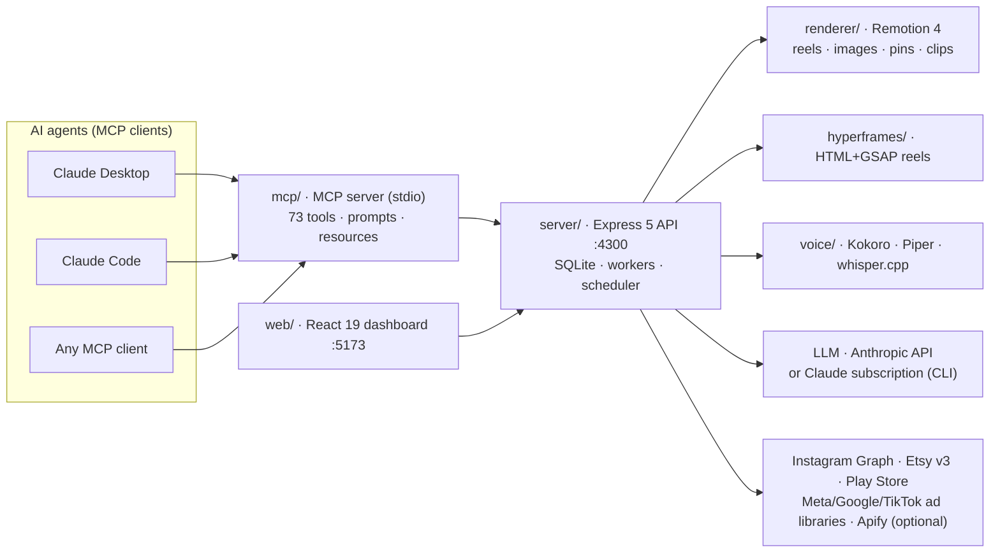

# Social MCP Studio

**An agentic, local-first marketing operating system, exposed to AI agents through the Model Context Protocol (MCP).**

Give it a website, an Etsy shop or a Play Store listing. It builds a *Brand Brain*, researches your competitors and their ads, plans your calendar, writes the scripts, renders finished reels, carousels, stories, image posts and Pinterest pins (voiceover, word-timed captions, music, brand design), and queues everything for a one-tap approval. Then it publishes on schedule and turns comments into DMs.

Everything runs on your own machine. Every capability is also an **MCP tool**, so Claude (Desktop, Code or any MCP-compatible agent) can drive the whole pipeline in natural language: *"Research my competitors, apply the strategy to the brand, fill next week with 4 reels and 3 image posts in the Persian style, and queue Pinterest pins for my newest listings."*


---

## Table of contents

- [Why this exists](#why-this-exists)
- [What it does](#what-it-does)
- [Architecture](#architecture)
- [MCP: drive it from Claude](#mcp-drive-it-from-claude)
- [Quick start](#quick-start)
- [Feature deep-dive](#feature-deep-dive)
- [Multi-agent workflows](#multi-agent-workflows)
- [Integrations and keys](#integrations-and-keys)
- [HTTP API](#http-api)
- [Project layout](#project-layout)
- [Design principles](#design-principles)
- [Roadmap](#roadmap)
- [Work with me](#work-with-me)
- [License](#license)

---

## Why this exists

Small brands lose on consistency, not on ideas. The tooling is fragmented: one SaaS for research, one for design, one for video, one for captions, one for scheduling, one for DMs, and none of them talk to an AI agent properly.

Social MCP Studio collapses that stack into **one local engine with an agent-native interface**:

| Instead of… | You get… |
|---|---|
| Copy-pasting between ChatGPT, Canva, CapCut, Later | One pipeline: research → strategy → script → render → approve → publish |
| Paying per seat, per render, per minute of voice | Free local TTS (Kokoro / Piper), free local transcription (whisper.cpp), free CPU rendering (Remotion) |
| A chatbot that *talks about* marketing | An agent that *does* marketing through 73 typed MCP tools, with hard safety rails |
| Guessing what competitors do | A research engine that reads the Meta Ad Library, Google Ads Transparency Center and TikTok Ad Library |
| Your brand data on someone's server | SQLite in a folder you own; your LLM key or your Claude subscription |

---

## What it does

```
 website / Etsy shop / Play Store link
            │
            ▼
   ┌─────────────────┐     ┌────────────────────┐
   │   Brand Brain   │◀────│  Market research    │  competitors · their ads (Meta/Google/TikTok)
   │ voice · pillars │     │  + strategy engine  │  hooks · offers · CTAs · 30-day plan · KPIs
   │ CTAs · keywords │     └────────────────────┘
   └────────┬────────┘
            ▼
   ┌─────────────────┐   autopilot fills the next 7 days: pillars × formats × occasions
   │  Planner / LLM  │   (Eid, Black Friday, Christmas, …) into best-time slots
   └────────┬────────┘
            ▼
   ┌───────────────────────────────────────────────────────────┐
   │ Render engines                                            │
   │  Remotion reels (15 styles) · HyperFrames HTML reels      │
   │  4:5 image posts · carousels · stories · 2:3 Pinterest    │
   │  Kokoro/Piper voiceover · whisper word captions · music   │
   │  English · Urdu (Nastaliq) · Roman Urdu · Arabic (Naskh)  │
   └────────────────────────────┬──────────────────────────────┘
                                ▼
            Approve screen ──▶ scheduler ──▶ Instagram / Pinterest
                                            comment → keyword → DM
```

- **Brand Brain** — a structured brand model (voice, colours, pillars, CTAs, keywords, competitors, claims to avoid, best posting times) built by an LLM from your site and refined by research. Every generator reads it.
- **Market research** — finds real competitors, profiles their sites, pulls their ads from three ad libraries (count, run-time, hooks, offers, CTAs, longest-running "winners"), compares Instagram cadence, then writes a full strategy: positioning, messaging, 30-day content plan, ad concepts, SEO keywords, quick wins, KPIs. One click applies it to the Brand Brain.
- **Autopilot** — keeps every brand's next week full against a weekly target, rotating pillars, formats and seasonal occasions. New posts wait for approval unless you opt into auto-approve.
- **Reels** — 15 Remotion styles (cinematic, magazine, neon, paper, blueprint, zine, Persian tile-art, …), 9 caption styles, 6 HyperFrames HTML templates, plus fully custom HTML+GSAP reels written by the agent. Voiceover, word-timed captions, loudness-matched music (-14 LUFS) on every reel.
- **Image posts, carousels, stories** — designed 4:5 graphics (tips, quotes, polls, spotlights, offers, facts), multi-slide carousels, 9:16 stories.
- **Long video → clips** — drop a 10–60 minute lesson; local whisper.cpp transcribes it, the picker finds the best 20–60 s moments (LLM or rule-based), and each becomes a captioned vertical reel with title bar, logo and progress bar. Think Opus Clip, offline.
- **Pinterest** — fresh 2:3 pin designs from listings and video pins from reels, Pinterest-search copy, board selection, N-per-day queue, and a **claim/lease protocol** so a second agent publishes them without the Pinterest API.
- **Etsy** — imports the whole shop (listings, photos, tags, reviews) and turns listings into reels, posts and pins with comment-to-DM link delivery.
- **Google Play** — imports an app listing (description, features, icon, screenshots) and renders screenshots inside a phone frame.
- **Instagram growth** — comment keyword → auto-reply + DM automations, hashtag sets, alt text, insights.
- **Multilingual** — English, Urdu (proper Nastaliq), Roman Urdu and Arabic (proper Naskh), with matching neural voices.

---

## Architecture



**Design notes**

- **Agent-native by construction.** The dashboard and the MCP server consume the *same* HTTP API; nothing is UI-only. Anything a human can click, an agent can call.
- **Typed contracts.** `shared/types.ts` is the single source of truth for every spec (ReelSpec, ImageSpec, PinImageSpec, ResearchReport, …) shared by server, renderer, MCP and web.
- **Queues and workers in-process.** Render, voice, research and publish workers run inside the server with priorities (clip jobs yield to normal reels), leases and retries.
- **LLM abstraction.** One `askJson()` boundary. Backed by the Anthropic API *or* by your Claude Code subscription (spawning the `claude` CLI with an OAuth token), selectable in Settings.
- **Independent packages, no workspace coupling.** Each folder is its own npm package; the renderer and voice packages can be reused standalone.

---

## MCP: drive it from Claude

The `mcp/` package is a **Model Context Protocol** server exposing 73 tools, guided prompts and resources. Claude reads the Brand Brain, plans, creates, waits for renders, inspects results, requests changes and reports back, while hard rules prevent it from approving or publishing anything without your explicit say-so in the conversation.

```bash
npm run mcp:config    # prints the config with resolved absolute paths
npm run claude:add    # Claude Desktop: run with Claude fully quit, then reopen
```

For Claude Code: `claude mcp add --scope user social-mcp-studio -e SOCIAL_MCP_API=http://localhost:4300 -- node <path>/mcp/node_modules/tsx/dist/cli.mjs <path>/mcp/src/index.ts`

### Tool catalogue

| Domain | Tools |
|---|---|
| Brand & strategy | `list_brands` `create_brand` `get_brand` `analyze_brand` `update_brand_brain` `run_audit` `get_latest_audit` `plan_content` `suggest_hooks` `apply_hook` `list_occasions` |
| Market research | `research_start` `research_status` `research_report` `research_add_findings` `research_apply` |
| Content creation | `create_reel` `create_html_reel` `create_reel_from_html_template` `create_image_post` `update_image_post` `create_carousel` `create_story` `render_cover` `request_change` `update_post` `wait_for_render` `get_post` `list_posts` `delete_post` |
| Clips | `clips_start_job` `clips_job_status` `clips_make_custom` |
| Media & audio | `list_assets` `upload_asset` `search_stock` `add_stock_asset` `list_styles` `list_html_templates` `list_voices` `list_music` `set_post_music` `generate_alt_text` |
| Autopilot & calendar | `get_autopilot` `set_autopilot` `run_autopilot` `autopilot_digest` `get_calendar` |
| Publishing & growth | `approve_post` `publish_now` `preview_publish` `connect_instagram_url` `instagram_insights` `set_growth_options` `create_automation` `list_automations` `delete_automation` `get_comment_log` |
| Etsy & Play Store | `etsy_import` `etsy_list_listings` `etsy_add_listing` `etsy_create_posts` `playstore_import` `playstore_get` |
| Pinterest | `pinterest_settings` `pinterest_status` `pinterest_generate` `pinterest_queue` `pinterest_update_pin` `pinterest_claim_next` `pinterest_mark_published` `pinterest_mark_failed` `pinterest_release` |

Prompts: `pinterest_publisher`, course/academy and product-shop playbooks. Resources: `social-mcp://guides/reelspec`, `social-mcp://styles`, `social-mcp://guides/hyperframes`.

### Safety rails baked into the server

- Nothing is approved, scheduled or published without a human decision; `publish_now` requires an explicit `userConfirmed` flag and the MCP instructions forbid calling it on the agent's own initiative.
- No credentials ever pass through the agent: Instagram is connected via an OAuth URL the user opens; tokens live in the local SQLite only.
- Pins are handed out on a 30-minute lease and must be reported back (published / failed / released) so no item is lost between agents.

---

## Quick start

Requirements: Windows / macOS / Linux, **Node 24+**, ~4 GB free disk for models and renders. No GPU required.

```bash
git clone https://github.com/furqankhyraj/marketing_studio.git
cd marketing_studio
npm run setup     # installs every package (server, web, renderer, hyperframes, voice, mcp)
npm start         # API on http://localhost:4300 · dashboard on http://localhost:5173
```

1. Open **http://localhost:5173** → *New brand* → paste a website, Etsy shop or Play Store URL.
2. **Settings** → add an Anthropic key *or* paste a Claude Code subscription token (`claude setup-token`). Optional: Pexels/Pixabay, Etsy, Apify.
3. **Market research** → run it, read the strategy, *Apply to Brand Brain*.
4. **Autopilot** → set weekly targets and switch it on, or create posts by hand / from Claude.
5. **Approve** → swipe through rendered posts; approved ones publish at their best-time slot.

Renders land in `data/renders/<postId>/r<revision>/`; everything stateful lives under `data/`.

---

## Feature deep-dive

### Brand Brain
An LLM reads the brand's site (or listing) and produces a structured profile: voice and tone, colour palette, content pillars, CTAs, search keywords, differentiators, competitors, claims to avoid, best posting times, language. Research results merge into it without overwriting your edits. Every writer in the system (planner, autopilot, pin copy, change requests) is grounded in this object, so output stays on-brand across hundreds of posts.

### Market research & strategy engine
Pipeline: `intake → keywords → discover → profile → social → ads → analyze → strategy`.
- **Discovery**: Google search + LLM reasoning; Etsy competitors via the Etsy API weighted by real sales; app competitors via Play Store.
- **Ads**: Meta Ad Library, Google Ads Transparency Center and TikTok Ad Library via Apify actors, or hand-collected findings pushed through `research_add_findings` (an agent can browse the ad libraries itself and feed what it saw).
- **Analysis**: ad counts per platform, active vs. inactive, longest-running creatives (proven winners), hooks / offers / CTAs, posting cadence.
- **Strategy**: positioning, messaging pillars, 30-day content plan, ad concepts to test, SEO keyword list, quick wins, KPIs. Exported as JSON or Markdown; applied to the Brand Brain in one call; optional weekly refresh.

### Rendering
- **Remotion** reels at 1080×1920, 15 visual styles × 9 caption styles, kinetic typography, transitions, brand chrome, CTA cards. Image posts at 4:5, pins at 2:3, carousels, stories.
- **Persian / Islamic art design system**: six illustrated card variants (mihrab, toranj, tazhib, kashi, shab, kaghaz) with tile-work, muqarnas, foil text and lanterns, used across reels, image posts and pins.
- **HyperFrames**: HTML + GSAP reels from six templates, or fully custom HTML the agent writes, rendered to MP4.
- **Audio**: Kokoro (English) and Piper (Urdu, Arabic) neural voices run locally; whisper.cpp produces word timings for karaoke captions; eight royalty-free generated music tracks (or yours) are ducked under the voice and mastered to -14 LUFS.
- **Typography**: Noto Nastaliq Urdu for Urdu, Noto Naskh Arabic for Arabic (never the other way round), script auto-detection per text block.

### Clips (long video → reels)
Chunked local transcription with progress and resumability, SRT/VTT import, hook scoring (questions, numbers, "mistake", "secret", Urdu equivalents), layout detection (screen recording / talking head / split), ±5 s trims via chat ("start 3 seconds earlier"), low-priority queue so it never blocks normal renders.

### Pinterest without an API
The studio designs and queues pins; a publisher agent (another Claude session, or any HTTP client) **claims** the next due pin, uploads it on pinterest.com and **marks** it published with the pin URL. Leases expire after 30 minutes so a crashed worker never blocks the queue. Scheduled Claude tasks make this fully hands-off.

### Instagram growth
Keyword comment → public reply + DM with the link, automation per post, hashtag strategy, alt text generation, insights, best-time learning.

---

## Multi-agent workflows

The system is built for several agents to cooperate through the studio as shared state:

| Agent | Role | Runs |
|---|---|---|
| **Daily content agent** | Reads digest → runs autopilot → imports new listings → tops up pins → QA on new posts → morning summary | Scheduled, 08:00 |
| **Pinterest publisher** | Claims due pins, publishes in a browser, reports URLs | Scheduled, 5× daily |
| **Research agent** | Runs or refreshes competitor research, browses ad libraries, applies strategy | Weekly / on demand |
| **Human** | Approves, edits via chat, sets targets | Dashboard |

All of them use the same tools; the studio's leases, revisions and approval states keep them from stepping on each other.

---

## Integrations and keys

| Integration | Needed for | Cost |
|---|---|---|
| **Anthropic API** or **Claude Code subscription token** | Brand analysis, planning, scripts, research strategy, chat | Your plan |
| **Instagram API with Instagram Login** (Meta app) | Publishing, comments, DMs, insights | Free |
| **Etsy Open API v3** (seller app) | Full shop import | Free |
| **Pexels / Pixabay** | Stock b-roll for brands without media | Free |
| **Apify** | Automated ad-library / Instagram scraping in research | ≈ $1 per run; optional, agents can gather findings by hand |
| **Kokoro, Piper, whisper.cpp, Remotion, HyperFrames** | Voice, captions, rendering | Free, local |

No key is required to run the dashboard, render content or use the MCP tools; LLM-powered steps degrade to built-in rules when no model is configured.

---

## HTTP API

Every feature is a JSON endpoint on `:4300` (the dashboard and MCP server are both thin clients). Highlights:

```
POST /api/brands                      create a brand from a URL
GET  /api/brands/:id                  brand + Brand Brain
PATCH /api/brands/:id                 edit the brain
POST /api/brands/:id/research         start research   → job id
GET  /api/research/jobs/:jobId        progress + log
GET  /api/research/reports/:id?format=md
POST /api/research/reports/:id/apply  merge into Brand Brain
POST /api/research/reports/:id/findings   attach hand-gathered ads / metrics
POST /api/posts                       create reel / image / carousel / story
POST /api/posts/:id/change            natural-language change request → re-render
POST /api/posts/:id/approve           schedule
POST /api/pinterest/claim             lease next due pin
POST /api/pinterest/pins/:id/published {pinUrl}
POST /api/brands/:id/playstore/import {url}
```

Full request/response shapes live in `shared/types.ts`.

---

## Project layout

| Folder | Stack | Responsibility |
|---|---|---|
| `server/` | Express 5, `node:sqlite`, TypeScript | API, Brand Brain, planner, autopilot, research pipeline, render/voice/publish workers, scheduler, Instagram, Etsy, Play Store, Pinterest queue, chat agent |
| `renderer/` | Remotion 4, React | Reels, image posts, pins, carousels, stories, clip reels, Persian art components |
| `hyperframes/` | HTML + GSAP, Chromium | Template and free-form HTML reels |
| `voice/` | Kokoro, Piper, whisper.cpp | TTS in four languages, word timings, stock search |
| `web/` | Vite, React 19 | Dashboard: Home, Brand Brain, Plan, Approve, Calendar, Autopilot, Research, Clips, Etsy, Pinterest, Instagram, Automations, Library, Styles, Settings |
| `mcp/` | `@modelcontextprotocol/sdk`, zod | 73 tools, prompts, resources |
| `shared/` | TypeScript | Contracts shared by all packages |

---

## Design principles

1. **Local-first, privacy-first.** Your data, models and renders stay on your disk. The only outbound calls are the ones you configure.
2. **Agents do; humans decide.** Generation is unlimited, publication is gated. Every irreversible action has a human checkpoint.
3. **Grounded generation.** Every word is written against a structured Brand Brain and real competitor data, not a blank prompt.
4. **Composable engines.** Renderer, voice and research are independent packages behind typed contracts.
5. **Cheap at scale.** Zero marginal cost per render, per voice minute or per transcription minute.

---

## Roadmap

- Native Pinterest API publishing (alongside the agent protocol)
- TikTok and YouTube Shorts publishing
- A/B hook testing with automatic winner promotion
- Ad-creative generation straight from research "winners"
- GPU render path and avatar presenters
- Hosted multi-tenant mode

---

## Work with me

I build agentic marketing and content systems like this one for brands, agencies and SaaS teams: MCP servers and tool design, LLM pipelines grounded in real data, programmatic video (Remotion / HTML), multilingual TTS and captioning, Instagram / Pinterest / Etsy / Play Store integrations, and research automation over ad libraries.

If you want this adapted to your stack, extended with new channels, or a bespoke agent workflow built on top of it, open an issue on this repository or reach out through my GitHub profile.

---

## License

Source-available. You may read, run and fork this code for personal and evaluation use. Commercial use, redistribution or offering it as a service requires a licence from the author. Third-party components keep their own licences (Remotion: free for individuals and teams of up to three; HyperFrames: Apache-2.0; Kokoro, Piper and whisper.cpp: see their repositories).
