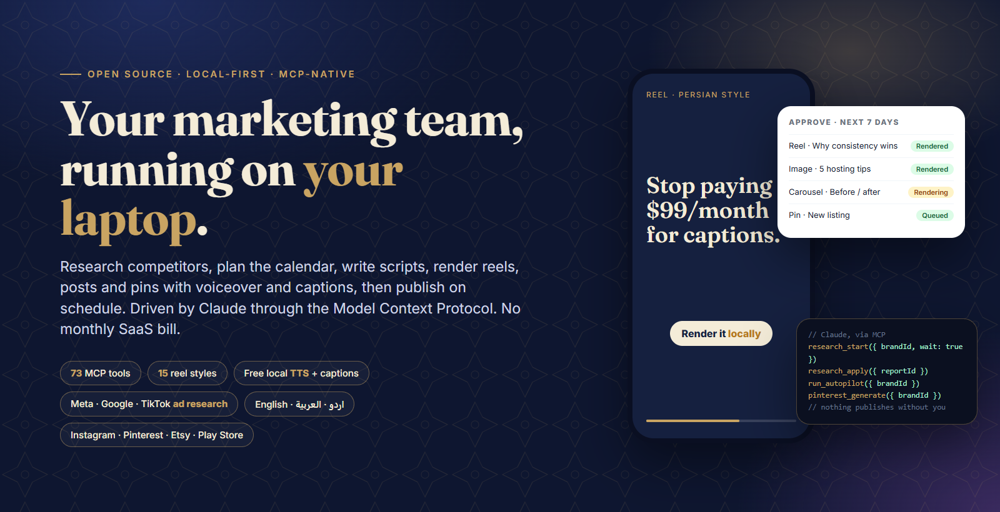
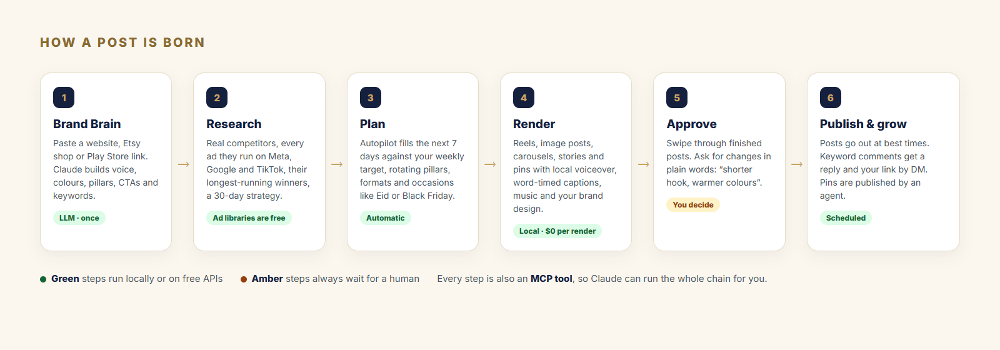
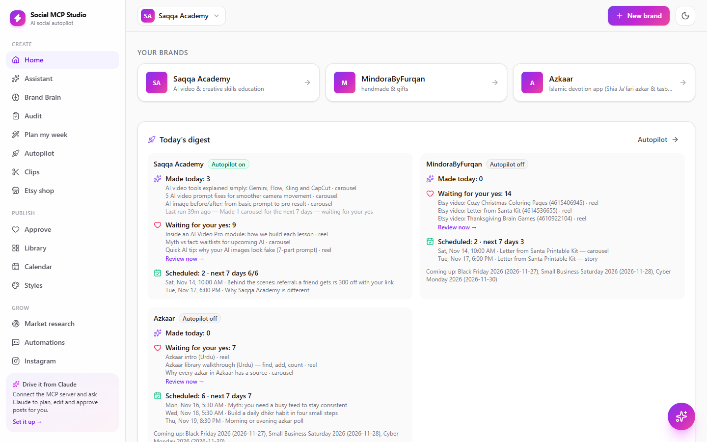
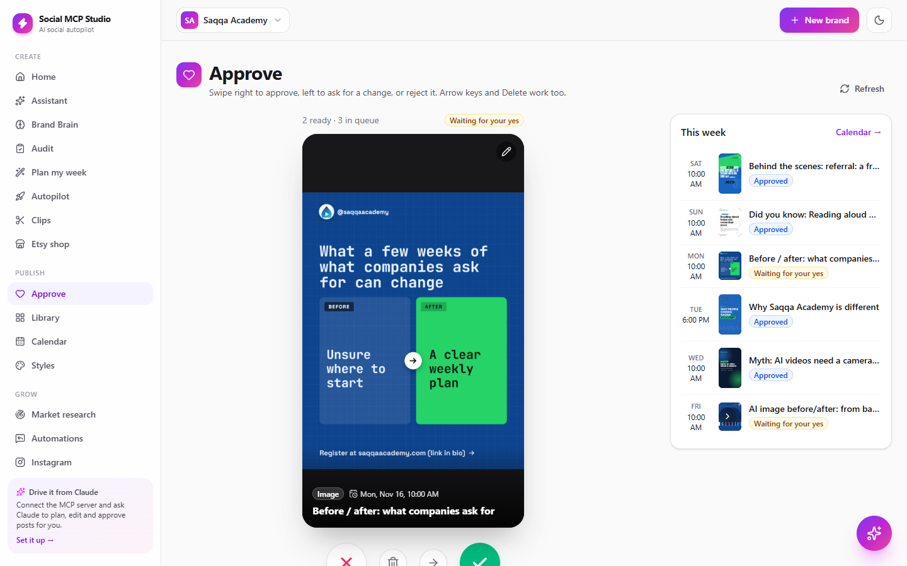
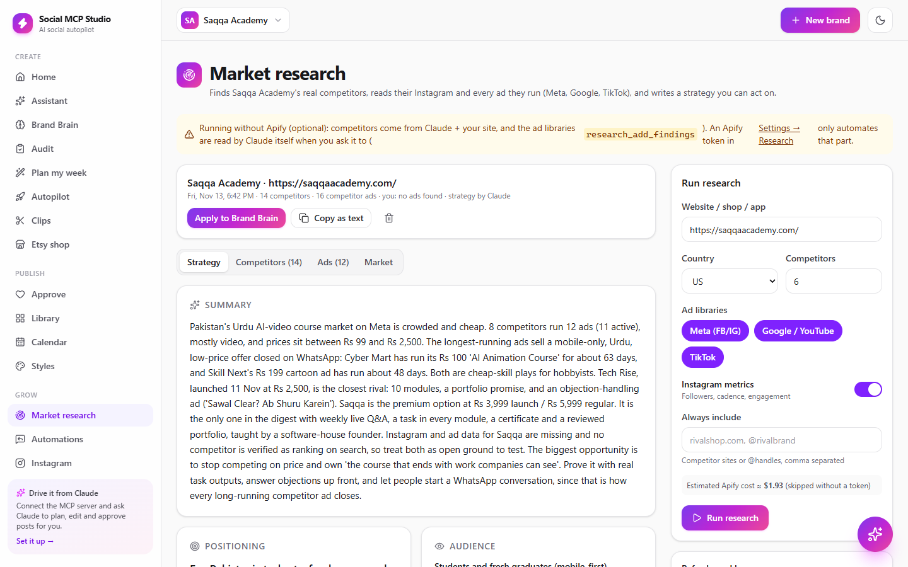
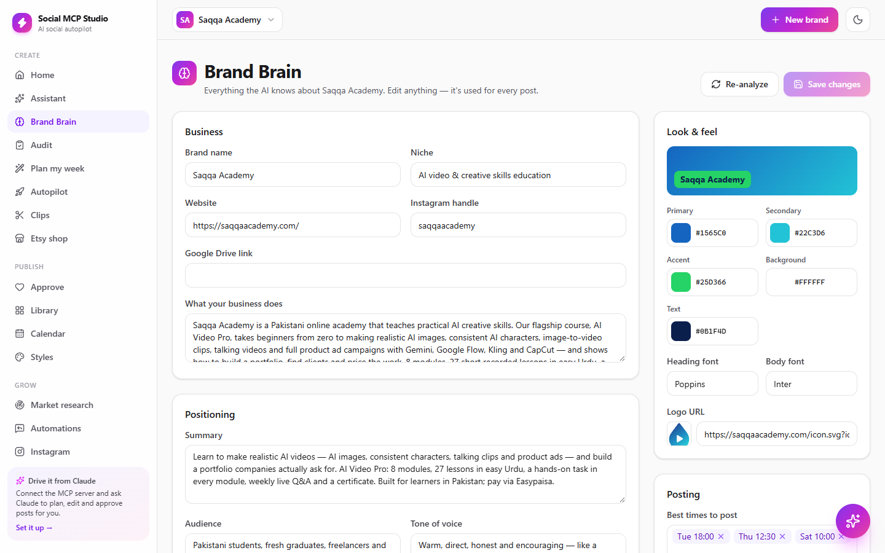
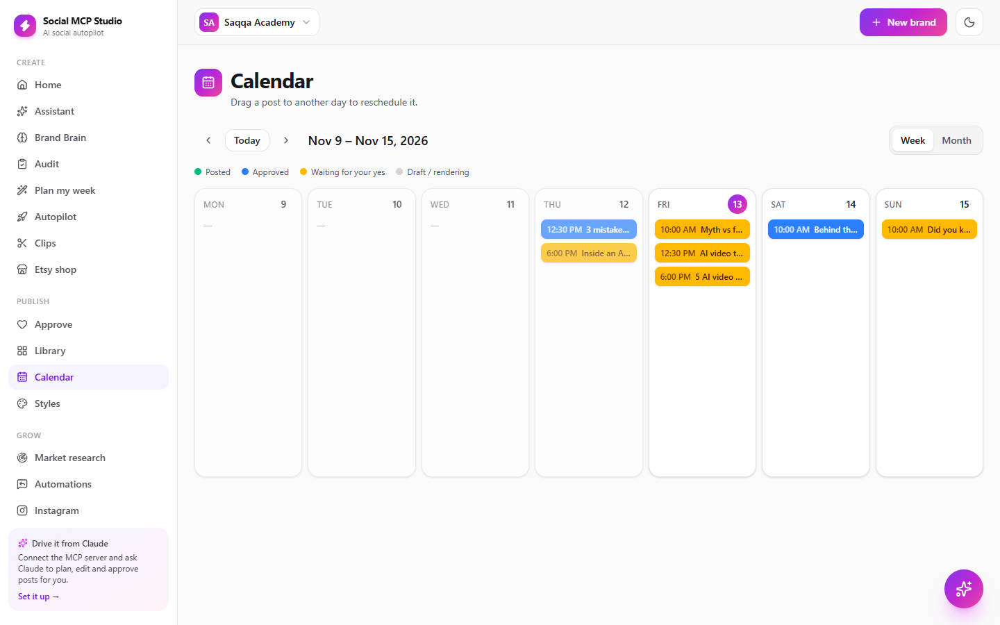
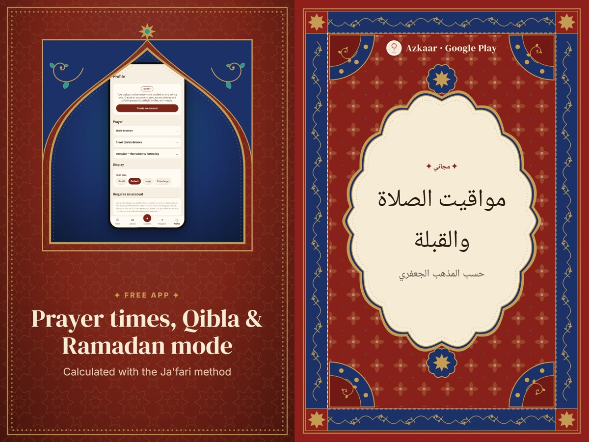
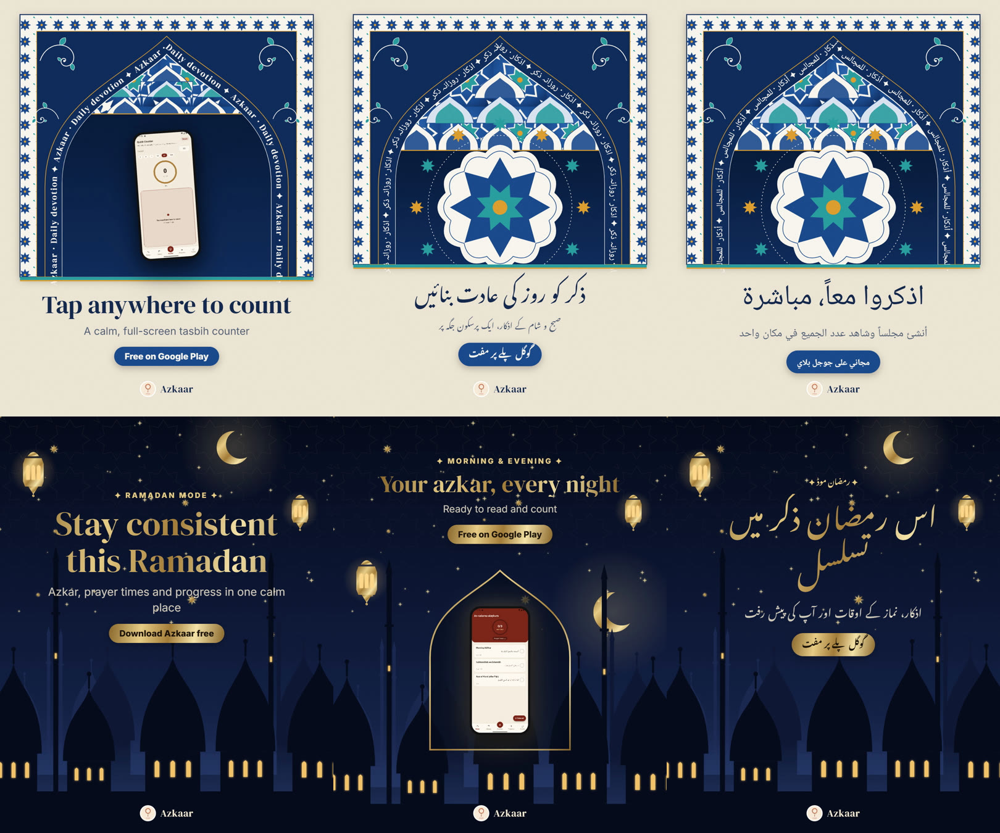
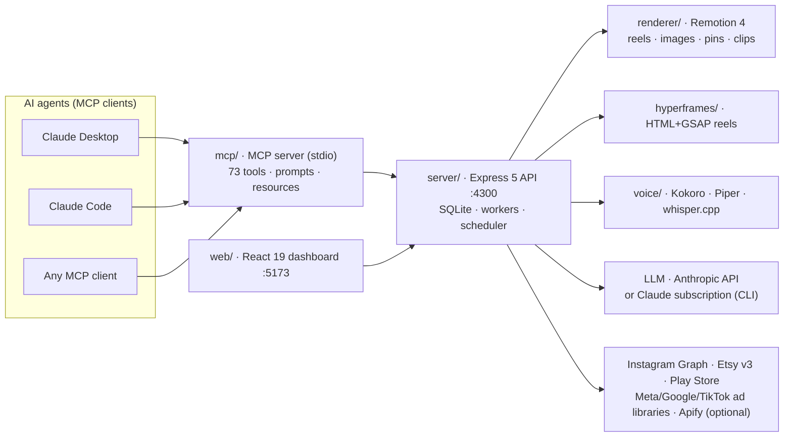

<p align="center">
  
</p>

<h1 align="center">Social MCP Studio</h1>

<p align="center"><b>A free, open-source, local-first marketing engine that AI agents drive through the Model Context Protocol (MCP).</b><br>
Stop renting five SaaS tools. Run the whole pipeline on your own laptop: research → strategy → scripts → rendered reels, posts and pins → approval → publishing.</p>

<p align="center">
  
  
  
  
  
  
  
</p>

---

## Why this exists

Most small brands don't lose because of bad ideas. They lose because consistency is expensive: a caption tool here, a design tool there, a video editor, a voiceover subscription, a scheduler, a research tool, and none of it talks to an AI agent properly. The bill is a few hundred dollars a month, and you still do the stitching by hand.

Social MCP Studio collapses that stack into **one engine you own**, with an **agent-native interface** so Claude can run it for you.

| Instead of paying for… | You get, for free, on your machine |
|---|---|
| A captions / voiceover subscription | Kokoro and Piper neural voices + whisper.cpp word-timed captions, offline |
| A video template tool | 15 Remotion reel styles, 9 caption styles, 6 HTML motion templates, Persian/Islamic art design system |
| A competitor-intelligence tool | A research engine that reads the Meta, Google and TikTok ad libraries and writes a 30-day strategy |
| A scheduler + DM automation | Best-time scheduling, keyword comment → reply + DM, Pinterest queue |
| A "chat with AI about marketing" add-on | 73 typed **MCP tools** so the agent *does* the work, with hard human-approval rails |
| Your brand data on someone's server | SQLite in a folder you own; your own Claude key or subscription |

> The aim is simple: help people market their work well without paying third parties every month.

---

## How a post is born

<p align="center"></p>

1. **Brand Brain** — paste a website, Etsy shop or Play Store link. Claude builds a structured brand model: voice, colours, pillars, CTAs, keywords, competitors, claims to avoid, best posting times. Every writer in the system reads it.
2. **Market research** — finds real competitors, pulls every ad they run (count, run-time, hooks, offers, CTAs, the longest-running "winners"), compares cadence, and writes a strategy: positioning, messaging, 30-day content plan, ad concepts, SEO keywords, quick wins, KPIs. One click applies it to the Brand Brain.
3. **Plan** — Autopilot keeps the next 7 days full against your weekly target, rotating pillars, formats and occasions (Eid, Black Friday, Christmas…).
4. **Render** — reels, image posts, carousels, stories and Pinterest pins with local voiceover, word-timed captions, music mastered to -14 LUFS and your brand design. English, Urdu (Nastaliq), Roman Urdu and Arabic (Naskh).
5. **Approve** — swipe through finished posts; ask for changes in plain words ("shorter hook, warmer colours").
6. **Publish & grow** — posts go out at best times; keyword comments get a reply and your link by DM; pins are published by an agent.

---

## See it

<table>
  <tr>
    <td width="50%"><br><sub><b>Home</b> — a daily digest per brand: made today, waiting for your yes, scheduled, upcoming occasions.</sub></td>
    <td width="50%"><br><sub><b>Approve</b> — swipe right to approve, left to request a change. Arrow keys work too.</sub></td>
  </tr>
  <tr>
    <td width="50%"><br><sub><b>Market research</b> — competitors, their ads, and a strategy you can apply to the brand.</sub></td>
    <td width="50%"><br><sub><b>Brand Brain</b> — everything the AI knows about the brand, editable.</sub></td>
  </tr>
  <tr>
    <td width="50%"><br><sub><b>Calendar</b> — drag a post to another day to reschedule it.</sub></td>
    <td width="50%"><br><sub><b>Pinterest pins</b> — fresh 2:3 designs generated from listings and reels.</sub></td>
  </tr>
</table>

<p align="center">
  <br>
  <sub>Reel frames in the <b>Persian Tile</b> style: Isfahan iwan, muqarnas, foil text, lanterns. Urdu and Arabic shown with the correct scripts.</sub>
</p>

<p align="center">
  <br>
  <sub>4:5 image posts: tips, quotes, spotlights and offers in the brand's palette.</sub>
</p>

---

## Setup guide (no technical background needed)

You need a Windows, Mac or Linux computer with about 4 GB of free disk space and an internet connection for the setup. No graphics card required. Budget 15–20 minutes the first time.

### 1. Install Node.js

Node.js is the free runtime the app runs on.

1. Go to **https://nodejs.org** and click the big **Download Node.js (LTS)** button.
2. Run the installer. Keep every default and click **Next** until it finishes.
3. Close any terminal windows that were open before the install.

### 2. Get the project

**Easiest:** click the green **Code** button at the top of this page → **Download ZIP**. Unzip it somewhere easy to find, for example `Documents\marketing_studio`.

**If you have Git:** `git clone https://github.com/furqankhyraj/marketing_studio.git`

### 3. Open a terminal in that folder

- **Windows:** open the folder in File Explorer, click the address bar at the top, type `cmd` and press **Enter**. A black window opens, already inside the folder.
- **Mac:** right-click the folder in Finder → **New Terminal at Folder** (or open Terminal and type `cd ` then drag the folder in).

### 4. Install everything (once)

Type this and press Enter:

```bash
npm run setup
```

It installs all packages (a few minutes). Wait until you see `All packages installed`. This step only runs once. The voice and caption models (a few hundred MB) download by themselves the first time a post is rendered, so the very first render takes longer.

### 5. Start the app

```bash
npm start
```

Leave this window open while you use the app; it is the engine. Then open your browser at **http://localhost:5173**.

To stop the app, go back to that window and press **Ctrl + C**. To start it again later, repeat step 3 and `npm start`.

### 6. Add your first brand

Click **New brand**, paste your website, Etsy shop or Play Store link, and wait a minute while the Brand Brain is built. Open **Brand Brain** and correct anything the AI got wrong; it's used for every post.

### 7. Connect Claude (for writing and research)

Open **Settings** in the app. Pick one:

- **Claude subscription (no extra cost if you already pay for Claude Pro/Max).** Install Claude Code once (`npm install -g @anthropic-ai/claude-code`), run `claude setup-token` in a terminal, copy the token it prints and paste it into *Settings → Claude subscription token*. Click **Test Claude**.
- **Anthropic API key** (pay as you go) from https://console.anthropic.com, pasted into *Settings → Anthropic API key*.

Without either, the app still renders everything; it just uses simpler built-in rules instead of Claude for writing.

### 8. Optional connections

| What | Where | Why |
|---|---|---|
| Instagram | **Instagram** page → connect | publishing, comments → DMs, insights |
| Etsy | Settings → Etsy (free seller app key) | import your whole shop |
| Pexels / Pixabay | Settings → Media (free keys) | stock b-roll for brands without media |
| Apify | Settings → Research (optional) | automates ad-library scraping; without it, Claude gathers the ads itself |

### 9. Let Claude drive it (optional)

- **Claude Desktop:** fully quit Claude (tray icon → Quit), run `npm run claude:add` in the terminal, reopen Claude. The Studio tools appear in every chat.
- **Claude Code:** run `npm run mcp:config` and paste the printed command.

Then just ask: *"Plan next week for my brand, 3 reels and 2 image posts, and show me when they're rendered."* Nothing is published until you approve it.

### If something goes wrong

| Symptom | Fix |
|---|---|
| `'npm' is not recognized` | Node.js isn't installed or the terminal was open before the install. Install Node, then open a **new** terminal. |
| `npm run setup` stops with a red error | Check your internet connection and run it again; it resumes where it stopped. |
| The page at localhost:5173 doesn't load | The `npm start` window must stay open. Look at it for a red error line. |
| First render is very slow | Normal: the first render after a start warms up the engine (a 20 s reel takes 3–4 minutes on a laptop CPU afterwards). |
| Windows SmartScreen / Defender prompt | Allow Node.js; it's the app's own engine listening on your computer only. |
| Something else | Open an issue on this repository with the red text from the terminal. |

**Updating:** download the ZIP again (or `git pull`), then run `npm run setup` once more. Your data stays in the `data/` folder.

---

## MCP: drive it from Claude

The `mcp/` package is a **Model Context Protocol** server exposing 73 tools, guided prompts and resources. Claude reads the Brand Brain, plans, creates, waits for renders, inspects results, requests changes and reports back, while hard rules stop it from approving or publishing anything without your explicit say-so in the conversation.

| Domain | Tools |
|---|---|
| Brand & strategy | `list_brands` `create_brand` `get_brand` `analyze_brand` `update_brand_brain` `run_audit` `get_latest_audit` `plan_content` `suggest_hooks` `apply_hook` `list_occasions` |
| Market research | `research_start` `research_status` `research_report` `research_add_findings` `research_apply` |
| Content creation | `create_reel` `create_html_reel` `create_reel_from_html_template` `create_image_post` `update_image_post` `create_carousel` `create_story` `render_cover` `request_change` `update_post` `wait_for_render` `get_post` `list_posts` `delete_post` |
| Clips | `clips_start_job` `clips_job_status` `clips_make_custom` |
| Media & audio | `list_assets` `upload_asset` `search_stock` `add_stock_asset` `list_styles` `list_html_templates` `list_voices` `list_music` `set_post_music` `generate_alt_text` |
| Autopilot & calendar | `get_autopilot` `set_autopilot` `run_autopilot` `autopilot_digest` `get_calendar` |
| Publishing & growth | `approve_post` `publish_now` `preview_publish` `connect_instagram_url` `instagram_insights` `set_growth_options` `create_automation` `list_automations` `delete_automation` `get_comment_log` |
| Etsy & Play Store | `etsy_import` `etsy_list_listings` `etsy_add_listing` `etsy_create_posts` `playstore_import` `playstore_get` |
| Pinterest | `pinterest_settings` `pinterest_status` `pinterest_generate` `pinterest_queue` `pinterest_update_pin` `pinterest_claim_next` `pinterest_mark_published` `pinterest_mark_failed` `pinterest_release` |

Prompts: `pinterest_publisher`, course/academy and product-shop playbooks. Resources: `social-mcp://guides/reelspec`, `social-mcp://styles`, `social-mcp://guides/hyperframes`.

**Safety rails baked into the server**

- Nothing is approved, scheduled or published without a human decision; `publish_now` requires an explicit `userConfirmed` flag and the MCP instructions forbid calling it on the agent's own initiative.
- **Approval is tied to the exact post.** It covers the words, media, account and time that were approved. Any edit after approval, by any tool or agent, sends the post back to "needs review"; a change request does the same after its re-render.
- **Comment → DM automations need their own approval.** The MCP tool refuses to create one unless the user has seen the exact reply and DM wording and said yes.
- **Visible action history.** Every state change (created, edited, approved, change requested, rescheduled, published, deleted, automation created) is recorded with who caused it: `dashboard`, `claude-mcp` or `system`. It's shown on each post and available at `GET /api/posts/:id/events` and `GET /api/brands/:id/events`.
- No credentials pass through the agent: Instagram is connected via an OAuth URL the user opens; tokens live in the local SQLite only.
- Competitor pages and ads enter the research step as quoted data; the strategy they produce only reaches the Brand Brain when a human clicks "apply".
- Pins are handed out on a 30-minute lease and must be reported back (published / failed / released), so no item is lost between agents.

### Multi-agent workflows

| Agent | Role | Runs |
|---|---|---|
| **Daily content agent** | Reads the digest → runs autopilot → imports new listings → tops up pins → QA on new posts → morning summary | Scheduled, 08:00 |
| **Pinterest publisher** | Claims due pins, publishes them in a browser, reports URLs | Scheduled, 5× daily |
| **Research agent** | Runs or refreshes competitor research, browses the ad libraries, applies the strategy | Weekly / on demand |
| **Human** | Approves, edits via chat, sets targets | Dashboard |

All of them use the same tools; leases, revisions and approval states keep them from stepping on each other.

---

## Architecture



- **Agent-native by construction.** The dashboard and the MCP server consume the same HTTP API; nothing is UI-only. Anything a human can click, an agent can call.
- **Typed contracts.** `shared/types.ts` is the single source of truth for every spec (ReelSpec, ImageSpec, PinImageSpec, ResearchReport…) shared by server, renderer, MCP and web.
- **Queues and workers in-process.** Render, voice, research and publish workers run inside the server with priorities (clip jobs yield to normal reels), leases and retries.
- **LLM abstraction.** One `askJson()` boundary, backed by the Anthropic API *or* your Claude Code subscription (the server spawns the `claude` CLI with an OAuth token). Selectable in Settings.
- **Independent packages.** Each folder is its own npm package; the renderer and voice packages are reusable standalone.

| Folder | Stack | Responsibility |
|---|---|---|
| `server/` | Express 5, `node:sqlite`, TypeScript | API, Brand Brain, planner, autopilot, research pipeline, render/voice/publish workers, scheduler, Instagram, Etsy, Play Store, Pinterest queue, chat agent |
| `renderer/` | Remotion 4, React | Reels, image posts, pins, carousels, stories, clip reels, Persian art components |
| `hyperframes/` | HTML + GSAP, Chromium | Template and free-form HTML reels |
| `voice/` | Kokoro, Piper, whisper.cpp | TTS in four languages, word timings, stock search |
| `web/` | Vite, React 19 | Dashboard: Home, Brand Brain, Plan, Approve, Calendar, Autopilot, Research, Clips, Etsy, Pinterest, Instagram, Automations, Library, Styles, Settings |
| `mcp/` | `@modelcontextprotocol/sdk`, zod | 73 tools, prompts, resources |
| `shared/` | TypeScript | Contracts shared by all packages |

---

## Feature deep-dive

**Market research & strategy engine.** Pipeline `intake → keywords → discover → profile → social → ads → analyze → strategy`. Discovery via LLM reasoning plus the Etsy API (weighted by real sales) and Play Store. Ads from the Meta Ad Library, Google Ads Transparency Center and TikTok Ad Library, either through Apify actors or through `research_add_findings`, where the agent browses the libraries itself and feeds back what it saw. Analysis: ad counts per platform, active vs inactive, longest-running creatives, hooks / offers / CTAs, posting cadence. Output: positioning, messaging, 30-day plan, ad concepts, SEO keywords, quick wins, KPIs; JSON or Markdown; one-call apply to the Brand Brain; optional weekly refresh.

**Rendering.** Remotion at 1080×1920, 15 visual styles × 9 caption styles, kinetic typography, transitions, brand chrome, CTA cards; image posts 4:5, pins 2:3, carousels, stories. A Persian/Islamic design system with six illustrated card variants (mihrab, toranj, tazhib, kashi, shab, kaghaz). HyperFrames HTML+GSAP reels from six templates or fully custom HTML written by the agent. Kokoro (English) and Piper (Urdu, Arabic) voices run locally; whisper.cpp gives word timings for karaoke captions; eight royalty-free generated tracks (or yours) are ducked under the voice and mastered to -14 LUFS. Noto Nastaliq for Urdu, Noto Naskh for Arabic, script auto-detection per text block.

**Clips (long video → reels).** Chunked local transcription with progress and resumability, SRT/VTT import, hook scoring (questions, numbers, "mistake", "secret", Urdu equivalents), layout detection (screen recording / talking head / split), ±5 s trims via chat, low-priority queue so it never blocks normal renders.

**Pinterest without an API.** The studio designs and queues pins; a publisher agent (another Claude session, or any HTTP client) claims the next due pin, uploads it on pinterest.com and marks it published with the pin URL. Leases expire after 30 minutes so a crashed worker never blocks the queue.

**Instagram growth.** Keyword comment → public reply + DM with the link, automation per post, hashtag strategy, alt text, insights, best-time learning.

---

## HTTP API

Every feature is a JSON endpoint on `:4300`; the dashboard and MCP server are both thin clients. Highlights:

```
POST  /api/brands                          create a brand from a URL
GET   /api/brands/:id                      brand + Brand Brain
PATCH /api/brands/:id                      edit the brain
POST  /api/brands/:id/research             start research → job id
GET   /api/research/jobs/:jobId            progress + log
GET   /api/research/reports/:id?format=md  report as Markdown
POST  /api/research/reports/:id/apply      merge into Brand Brain
POST  /api/research/reports/:id/findings   attach hand-gathered ads / metrics
POST  /api/posts                           create reel / image / carousel / story
POST  /api/posts/:id/change                natural-language change → re-render
POST  /api/posts/:id/approve               schedule
POST  /api/pinterest/claim                 lease the next due pin
POST  /api/pinterest/pins/:id/published    {pinUrl}
POST  /api/brands/:id/playstore/import     {url}
```

Request and response shapes live in `shared/types.ts`.

---

## Integrations and keys

| Integration | Needed for | Cost |
|---|---|---|
| **Anthropic API** or **Claude Code subscription token** | Brand analysis, planning, scripts, research strategy, chat | Your plan |
| **Instagram API with Instagram Login** (Meta app) | Publishing, comments, DMs, insights | Free |
| **Etsy Open API v3** (seller app) | Full shop import | Free |
| **Pexels / Pixabay** | Stock b-roll | Free |
| **Apify** | Automated ad-library / Instagram scraping in research | Optional (≈ $1 per run); agents can gather findings by hand instead |
| **Kokoro, Piper, whisper.cpp, Remotion, HyperFrames** | Voice, captions, rendering | Free, local |

---

## Design principles

1. **Local-first, privacy-first.** Your data, models and renders stay on your disk. The only outbound calls are the ones you configure.
2. **Agents do; humans decide.** Generation is unlimited, publication is gated. Every irreversible action has a human checkpoint.
3. **Grounded generation.** Every word is written against a structured Brand Brain and real competitor data, never a blank prompt.
4. **Composable engines.** Renderer, voice and research are independent packages behind typed contracts.
5. **Zero marginal cost.** No fee per render, per voice minute or per transcription minute.

---

## Roadmap

- Native Pinterest API publishing (alongside the agent protocol)
- TikTok and YouTube Shorts publishing
- A/B hook testing with automatic winner promotion
- Ad-creative generation straight from research "winners"
- GPU render path and avatar presenters
- Hosted multi-tenant mode

---

## Work with me

I build agentic marketing and content systems like this one for brands, agencies and SaaS teams: MCP servers and tool design, LLM pipelines grounded in real data, programmatic video (Remotion / HTML), multilingual TTS and captioning, Instagram / Pinterest / Etsy / Play Store integrations, and research automation over ad libraries.

Want this adapted to your stack, extended with new channels, or a bespoke agent workflow built on top of it? Open an issue on this repository or reach out through my GitHub profile.

---

## License

[MIT](LICENSE). Use it, change it, ship it. Third-party components keep their own licences (Remotion: free for individuals and teams of up to three; HyperFrames: Apache-2.0; Kokoro, Piper and whisper.cpp: see their repositories).
